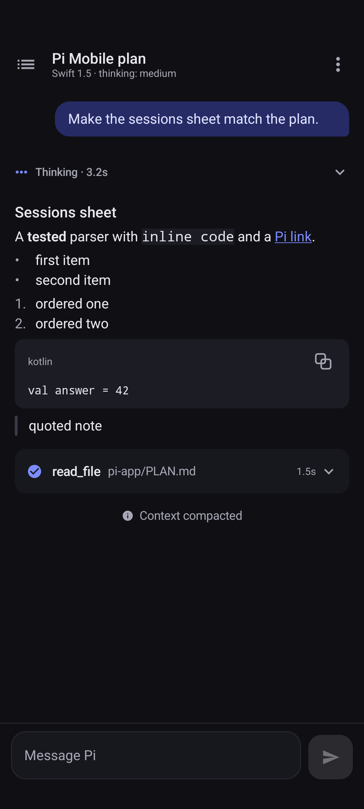
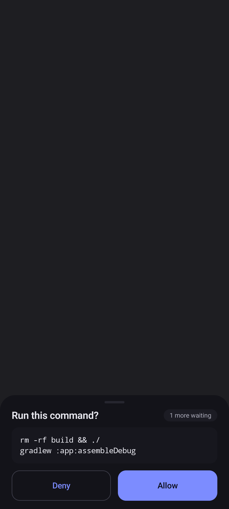

# Pi Mobile

A phone app for an assistant that runs on your own computer. It lets you start
a task from your phone, watch each step appear, and allow or block anything the
assistant wants to do. The app and the small helper program it talks to were
tested on a real Android phone against a local assistant, and the screenshots
and test results are included.

## Purpose and gaps

Many coding assistants run in a terminal on a desktop computer. When you step
away from the desk, the work continues but is invisible, and any request that
needs your permission blocks until you return to the terminal. Pi offers a
programmatic control channel for building other interfaces [1], and a
third-party extension exposes it over a local network [2], but neither provides
a phone interface designed for answering permission requests and reading long
output on a small screen. This repository contains that phone interface and a
small host launcher around the existing extension.

## Features

- Connect to the host with a private network address and the six-digit PIN it
  prints; the PIN is masked while typing and sealed with the phone's keystore.
- Watch a run live: streaming text, collapsible thinking, and tool cards whose
  output expands in place.
- Answer blocking requests in bottom sheets: yes/no confirmation, option lists,
  short text, and multi-line editor.
- Queue a message while a run is active, send a follow-up, or stop the run.
- Start a new chat in any workspace folder: pick a folder from the host's
  recent projects or type an absolute path, and the host verifies it first.
- Browse the host's sessions grouped by project, reopen one, rename or delete,
  and confirm before switching mid-run.
- Run extension commands, prompt templates and skills from the composer: type
  `/` and pick from the list the host reports.
- See plan mode and other extensions: status entries and todo widgets appear
  above the composer, and extensions can place text in the composer.
- Switch model and thinking level, and read session token and cost statistics.
- Receive approvals and completion alerts while the app is in the background.
- Use one column at 360 dp, or a two-pane layout on wider screens.

## Not for, limitations

- Home network only, plain HTTP, one shared PIN. Do not expose the host to the
  internet.
- Requires the Pi coding agent to be installed and configured on the computer,
  plus a model backend. Neither is bundled.
- Killing the app process closes the connection and ends an in-flight run.
- The phone and the terminal share one session store; open a session on one
  side at a time, concurrent writers are not merged.
- Image attachments and iOS are not implemented. Windows is not covered by the
  host scripts.
- The first prompt after the desktop has been idle may wait for the local model
  to load.
- The instrumented tests were run on one phone model; other Android versions and
  manufacturers are untested.
- The command palette lists what the host reports (extension commands, prompt
  templates, skills). Commands that only exist in the terminal interface are
  not available.

## Screenshots



A reply with a collapsed thinking block and an expandable tool card, at 360 dp.



A blocking approval sheet with one more request waiting. Rendered by the
instrumented UI test with a synthetic command.

## Reproduction environment

| Item | Value |
| --- | --- |
| Desktop | Linux (Fedora), 32 GB RAM, two NVIDIA GPUs |
| Phone | ASUS_AI2302, Android 15 (API 35), 1080x2400 at 440 dpi |
| Assistant | Pi coding agent 1.4.0, `@earendil-works/pi-coding-agent` |
| Model backend | llama.cpp router on `127.0.0.1:8080` (optional; any Pi provider works) |
| Host extension | pi-rpc-web 0.1.1, commit `f8a1ba42d23e88ebcd6d44e8352e79ad4cdf4fd6` |
| Build | JDK 17, Android SDK 37, build-tools 36.0.0, Gradle 9.6.0, AGP 9.4.0, Kotlin 2.4.20 |
| Runtime for scripts | POSIX shell, `setsid`, `tar`, `sha256sum`, `curl` |

## Install and run

1. Install the assistant and fetch the pinned host extension:

   ```sh
   server/scripts/fetch-vendor.sh
   ```

2. Start the host on the computer:

   ```sh
   server/scripts/serve.sh
   ```

   It prints the address and PIN:

   ```text
   Pi LAN host running
     URL:        http://192.168.1.50:7690
     PIN:        123 456
   ```

3. Install `Pi-Mobile-1.2.0.apk` from the repository's releases on the phone,
   open the app, enter the address and PIN, and tap Connect.

4. Optional: install the desktop entry that starts the host and the terminal
   assistant in one window:

   ```sh
   server/launcher/install.sh
   ```

   Exit the terminal assistant with Ctrl+D, or Ctrl+C twice quickly, to stop the
   host as well.

Build the app yourself with:

```sh
./gradlew :app:assembleDebug
./gradlew :app:testDebugUnitTest
```

## Uninstall

```sh
server/launcher/install.sh uninstall   # desktop entry and menu link
server/scripts/stop.sh                 # stop the host
adb uninstall dev.pi.mobile                   # remove the app and its sealed PIN
```

Session files under `~/.pi/agent/sessions` and the host's `server/runtime/`
directory are left in place; delete them yourself if they are no longer wanted.

## Troubleshooting

- **The phone cannot reach the host, but its browser can open the address.**
  On Android 16 and newer, access to the local network is gated by the system.
  Open Settings > Apps > Pi Mobile > Permissions > Nearby devices, allow it,
  then tap Connect again. A failed connection on those versions shows the same
  hint inside the app.
- **The sessions list is empty on a test host.** Test mode keeps its own
  session store under `server/runtime/pi-home`; sessions created before a host
  restart are not migrated.

## Layout

| Component | Path | Contents | Class |
| --- | --- | --- | --- |
| Android app | `app/` | Kotlin and Compose sources, JVM tests, Compose and screenshot tests, app README | Original |
| Host | `server/` | Launcher, status and stop scripts, PIN and session plumbing, smoke test, desktop entry, host README | Original |
| Screenshots | `docs/screens/` | Five phone screenshots referenced above and in `app/README.md` | Original |
| Build | `gradle/`, `gradlew`, `*.gradle.kts` | Gradle wrapper, version catalogue, app build | Original |
| Notices | `THIRD_PARTY.md` | Upstream attribution and licence texts | Original |
| pi-rpc-web | fetched into `server/vendor/` | Not committed; pinned upstream sources | Third-party |

## Results

| Check | Result |
| --- | --- |
| JVM unit tests | 110 tests, 0 failures (`:app:testDebugUnitTest`) |
| Instrumented UI and screenshot tests | 100 tests, 0 failures on the ASUS phone (API 35) |
| Android lint | 0 errors, 25 warnings (dependency and target-version notices) |
| Host contract smoke test | 11 of 11 checks pass without a model call (`node server/tests/smoke.mjs`) |
| End-to-end on the phone | Connect, streaming, tool card, abort, approval allow and deny, background approval notification, session reopen, new chat, and the 360 dp / 1.3x text / light / landscape / keyboard layouts |

Not tested: other phone models or Android versions, iOS, Windows hosts, releases
built with another signing key, and the app on networks other than a private
home network. The end-to-end checks used the author's phone and were driven by
a harness that is not part of this repository; the instrumented tests above are
included and can be rerun.

## Acknowledgements

Pi-rpc-web by tohliheng provides the network bridge and its protocol, and the Pi
coding agent by Earendil Inc. provides the agent and control channel this app
talks to. JetBrains Kotlin, AndroidX, Gradle, OkHttp and llama.cpp are used as
documented in `THIRD_PARTY.md`.

## References

[1] Pi documentation, RPC mode and RPC commands, https://pi.dev/docs/latest/rpc
[2] pi-rpc-web, https://github.com/tohlh/pi-rpc-web, commit `f8a1ba42d23e88ebcd6d44e8352e79ad4cdf4fd6`, MIT
[3] Android Developers, foreground service types, https://developer.android.com/develop/background-work/services/fgs/service-types

## Licenses

Original code in this repository is MIT licensed; see `LICENSE`. Third-party
components, their versions, licences and full licence texts are listed in
`THIRD_PARTY.md`. The fetched pi-rpc-web sources keep their own MIT notice. You
must obtain the Pi coding agent and any model backend yourself under their own
terms.
